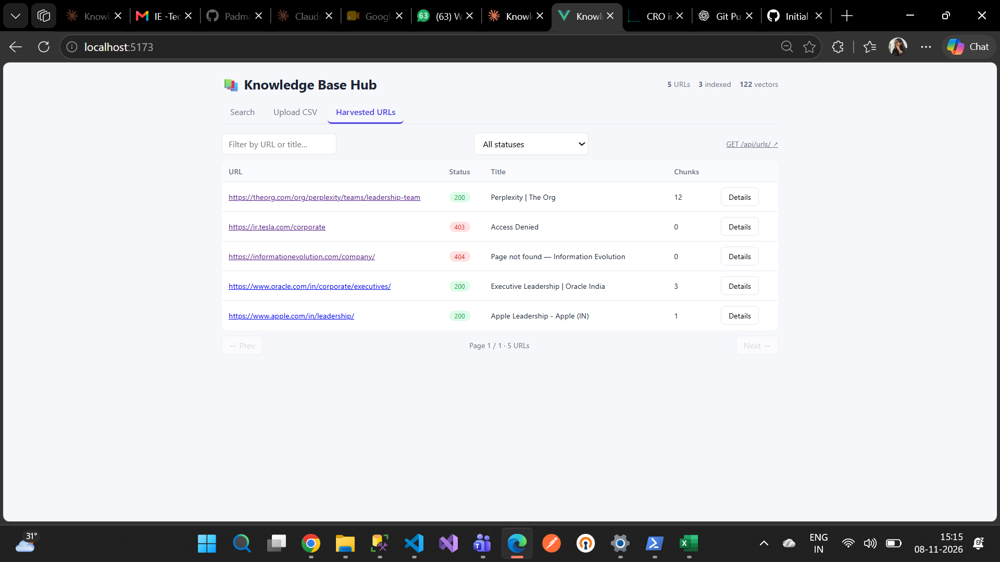
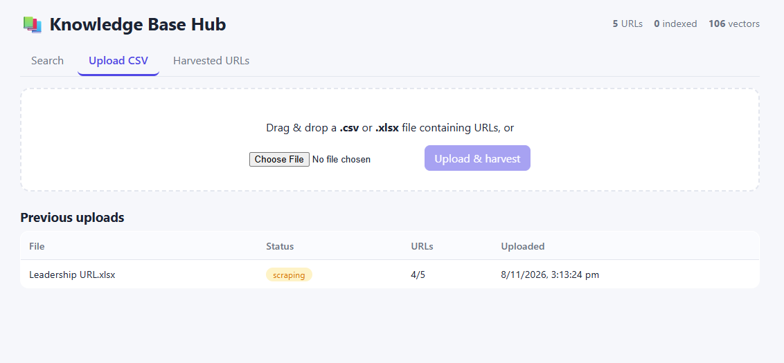
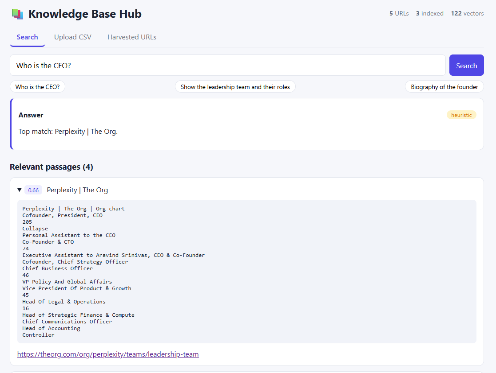

# Knowledge Base Hub

## Project Overview

Knowledge Base Hub is a web-based application that collects information from multiple websites, stores the extracted content, converts it into vector embeddings, and enables users to search the collected information using natural-language questions.

Users can upload a CSV or XLSX file containing website URLs. The application automatically harvests the web pages, extracts relevant content, stores the data in Microsoft SQL Server (MSSQL), and generates embeddings using Sentence Transformers and FAISS.

Users can then ask questions about executives, leadership teams, roles, biographies, and other information available in the indexed websites.

The application supports a local Large Language Model (LLM) through Ollama or compatible hosted APIs such as Groq and OpenRouter.

## Key Features

- Upload website URLs through CSV and XLSX files.
- Automatically extract and harvest website content.
- Store raw HTML, cleaned text, and metadata in MSSQL.
- Extract structured person information using JSON-LD.
- Split website content into heading-aware text chunks.
- Generate embeddings using Sentence Transformers.
- Store and retrieve vector embeddings using FAISS.
- Perform semantic search using natural-language queries.
- Generate structured answers using an LLM.
- Display people information, including names, roles, biographies, and source references.
- View harvested URLs, HTTP status codes, and indexing information.
- Support fallback extraction when an LLM is unavailable.

## Technology Stack

| Component            | Technology              |
| -------------------- | ----------------------- |
| Frontend             | React.js                |
| Frontend Tool        | Vite                    |
| Backend              | Python, Django          |
| API Framework        | Django REST Framework   |
| Database             | Microsoft SQL Server    |
| Database Integration | mssql-django            |
| Web Scraping         | Requests, BeautifulSoup |
| Embedding Model      | Sentence Transformers   |
| Embedding Model Name | all-MiniLM-L6-v2        |
| Vector Search        | FAISS                   |
| Local LLM            | Ollama                  |
| Hosted LLM Options   | Groq, OpenRouter        |
| Data Processing      | NumPy, OpenPyXL         |

## Architecture

The application follows a retrieval-based architecture that combines web scraping, database storage, text chunking, vector embeddings, semantic search, and LLM-based answer generation.

```text
                    React Frontend
                          |
             ---------------------------
             |                         |
       URL Upload                  Search Query
             |                         |
             v                         v
      POST /api/upload/         POST /api/search/
             |                         |
             v                         v
       CSV/XLSX Parsing         Query Embedding
             |                         |
             v                         v
       URL Extraction           FAISS Vector Search
             |                         |
             v                         v
       Web Page Scraping        Relevant Text Chunks
             |                         |
             v                         v
       MSSQL Database           LLM Answer Generation
             |                         |
             v                         v
       Text Chunking            Structured Response
             |
             v
    Sentence Transformers
             |
             v
       FAISS Vector Index
```

### Data Processing Workflow

1. Users upload a CSV/XLSX file containing website URLs.
2. The backend extracts URLs from the uploaded file.
3. A background thread processes the URLs using Requests and BeautifulSoup.
4. The application extracts raw HTML, cleaned text, page titles, metadata, and available structured person information.
5. Extracted information is stored in MSSQL.
6. Website content is divided into heading-aware text chunks.
7. Sentence Transformers generates vector embeddings for each chunk.
8. FAISS stores the embeddings for efficient similarity search.
9. When a user submits a question, the application generates an embedding for the query.
10. FAISS retrieves the most relevant chunks.
11. The retrieved information is passed to the configured LLM.
12. The application returns an answer with structured people information and source references.

### Retrieval and Fallback Mechanism

Retrieval is chunk-based. Each chunk retains its page title and section heading to provide context during semantic search.

JSON-LD Person records are converted into dedicated chunks to improve the retrieval of executive and leadership information.

If an LLM is unavailable, the API uses a regex-based fallback extractor so that search can still return results.

## Screenshots

The following screenshots demonstrate the main features of Knowledge Base Hub.

### 1. Harvested URLs



### 2. URL Upload and Ingestion



### 3. Search Results



## Demo Video

The following video demonstrates the main application workflow, including URL upload, web page harvesting, indexing, and natural-language search.

**Demo Video:** [Watch Knowledge Base Hub Demo](demo/knowledge-base-hub-demo.mp4)

## Prerequisites

Install the following before running the application:

- Python 3.10 or later
- Node.js 18 or later
- npm
- Microsoft SQL Server (local, Docker, or remote)
- Microsoft ODBC Driver 18 for SQL Server

### Optional Requirements

- Ollama for running a local LLM.
- Groq or OpenRouter API credentials for hosted LLM access.

## Installation and Setup

### 1. Clone the Repository

```bash
git clone https://github.com/Padmabanu020/kb-hub.git
cd kb-hub
```

### 2. Database Configuration

The application uses Microsoft SQL Server for storing harvested website content and related records.

You can use an existing SQL Server instance or configure one through Docker Compose.

If Docker is configured:

```bash
docker compose up -d
```

Configure the database connection values in the backend `.env` file.

If the project supports SQLite through its configuration, SQLite can also be used for a local test setup.

### 3. Backend Setup

Navigate to the backend directory:

```powershell
cd backend
```

Create a Python virtual environment:

```powershell
python -m venv .venv
```

Activate the virtual environment on Windows:

```powershell
.venv\Scripts\activate
```

On Linux/macOS:

```bash
source .venv/bin/activate
```

Install the Python dependencies:

```bash
pip install -r requirements.txt
```

Create the environment configuration file:

Windows:

```powershell
Copy-Item .env.example .env
```

Linux/macOS:

```bash
cp .env.example .env
```

Update the database and LLM configuration values in `.env`.

Run database migrations:

```bash
python manage.py migrate
```

If the project includes the custom `createdb_mssql` management command, run it before migrations to create the database:

```bash
python manage.py createdb_mssql
```

Start the Django development server:

```bash
python manage.py runserver
```

Backend URL:

`http://127.0.0.1:8000/`

### 4. Frontend Setup

Open a new terminal and navigate to the project root.

Go to the frontend directory:

```bash
cd frontend
```

Install frontend dependencies:

```bash
npm install
```

Start the Vite development server:

```bash
npm run dev
```

Frontend URL:

`http://localhost:5173/`

The frontend uses the Vite development configuration to proxy API requests to the backend.

### 5. Optional LLM Configuration

Knowledge Base Hub supports Ollama for local LLM execution.

Install Ollama and download the model:

```bash
ollama pull llama3.2
```

Start the Ollama service:

```bash
ollama serve
```

Alternatively, configure a compatible hosted LLM provider such as Groq or OpenRouter.

Configure the following environment variables in the backend `.env` file:

```text
LLM_BASE_URL=
LLM_MODEL=
LLM_API_KEY=
```

Use the appropriate values for your selected provider.

## Application Usage

### Step 1: Upload URLs

- Open the Knowledge Base Hub application.
- Navigate to the Upload CSV tab.
- Upload `sample_urls.csv` or your own CSV/XLSX file.
- The application identifies website URLs from the uploaded file.

### Step 2: Harvest Website Content

- The backend processes the submitted URLs.
- Website content is extracted using Requests and BeautifulSoup.
- Raw HTML, cleaned text, metadata, and available structured information are stored in MSSQL.
- The application displays the harvesting status.

### Step 3: Generate Embeddings

- Extracted content is divided into smaller text chunks.
- Sentence Transformers generates embeddings.
- The embeddings are stored in the FAISS vector index.

### Step 4: Search the Knowledge Base

- Navigate to the Search tab.
- Enter a natural-language question.

Example questions:

- Who is the CEO?
- List the leadership team and their roles.
- Provide the biographies of the executives.
- What information is available about the management team?

The application retrieves relevant information and generates answers using the configured LLM.

### Step 5: View Harvested URLs

Navigate to the Harvested URLs tab to inspect:

- Submitted URLs
- HTTP status codes
- Page titles
- Extracted metadata
- Indexing status
- Raw HTML content

## REST API Documentation

The backend exposes REST API endpoints through Django REST Framework.

| Method | Endpoint             | Description                                           |
| ------ | -------------------- | ----------------------------------------------------- |
| GET    | `/api/urls/`         | Retrieve harvested URLs and metadata                  |
| GET    | `/api/urls/<id>/`    | Retrieve an individual harvested URL                  |
| POST   | `/api/upload/`       | Upload a CSV/XLSX file and start harvesting           |
| GET    | `/api/batches/`      | Retrieve upload batches                               |
| GET    | `/api/batches/<id>/` | Retrieve individual batch progress                    |
| POST   | `/api/search/`       | Search the indexed knowledge base                     |
| POST   | `/api/reindex/`      | Rebuild the FAISS vector index                        |
| GET    | `/api/stats/`        | Retrieve application statistics and model information |

### Search API Example

Request:

```json
{
  "query": "Who is the CEO?",
  "top_k": 8,
  "use_llm": true
}
```

The search API returns an answer, relevant people information, and supporting passages based on the retrieved content.

### URL Listing API Example

```text
GET /api/urls/?light=1&http_status=200
```

Supported filters include:

- `batch`
- `http_status`
- `indexed`
- `q`
- `light`
- `page`

The `light=1` parameter can be used to omit raw HTML from the listing response.

## Sample Input

The repository includes `sample_urls.csv`, which can be used to test URL uploading and website harvesting.

Users can also upload their own CSV or XLSX files containing website URLs.

Supported URL column names include:

- `url`
- `link`
- `website`

The application can also scan other cells for URLs, and XLSX hyperlinks are supported.

## Model and Vector Index

The application uses the following components:

**Embedding Model:** `all-MiniLM-L6-v2`

**Vector Search:** FAISS

**Index Type:** `IndexIDMap2`

FAISS stores vector embeddings associated with chunk database IDs. This enables efficient retrieval of relevant content during search.

The persisted vector index is stored in:

```text
backend/vector_store/
```

The index can be rebuilt using the reindex API after changes to the embedding model or indexed content.

If model artifacts are not included in the repository, they can be regenerated using the configured embedding model.

## Testing

Run backend tests using Django's test framework:

```bash
cd backend
python manage.py test hub
```

## Limitations and Future Improvements

### Current Limitations

- Websites rendered entirely using JavaScript may return limited content when scraped using Requests.
- Some websites may block automated scraping and return HTTP 403 responses.
- Scraping currently uses background threads, which are suitable for an assignment or small-scale application but may need a task queue for production workloads.
- Search quality depends on the extracted website content, embedding model, and configured LLM.

### Future Improvements

- Support JavaScript-rendered websites using Playwright.
- Introduce Celery or RQ for background task processing.
- Improve structured entity extraction and retrieval accuracy.
- Support additional vector database integrations such as Milvus.
- Improve search relevance and response quality.
- Add authentication and role-based access control.

## Project Structure

```text
kb-hub/
│
├── backend/
│   ├── config/
│   ├── hub/
│   ├── vector_store/
│   ├── manage.py
│   ├── requirements.txt
│   ├── .env.example
│   └── .gitignore
│
├── frontend/
│   ├── src/
│   ├── index.html
│   ├── package.json
│   ├── package-lock.json
│   └── vite.config.js
│
├── screenshots/
│   ├── dashboard.png
│   ├── url-ingestion.png
│   └── search-results.png
│
├── demo/
│   └── knowledge-base-hub-demo.mp4
│
├── sample_urls.csv
├── docker-compose.yml
├── README.md
└── .gitignore
```

## Repository

**GitHub:** https://github.com/Padmabanu020/kb-hub

---

**Knowledge Base Hub**  
A semantic knowledge retrieval application combining web scraping, vector search, and Large Language Models.
